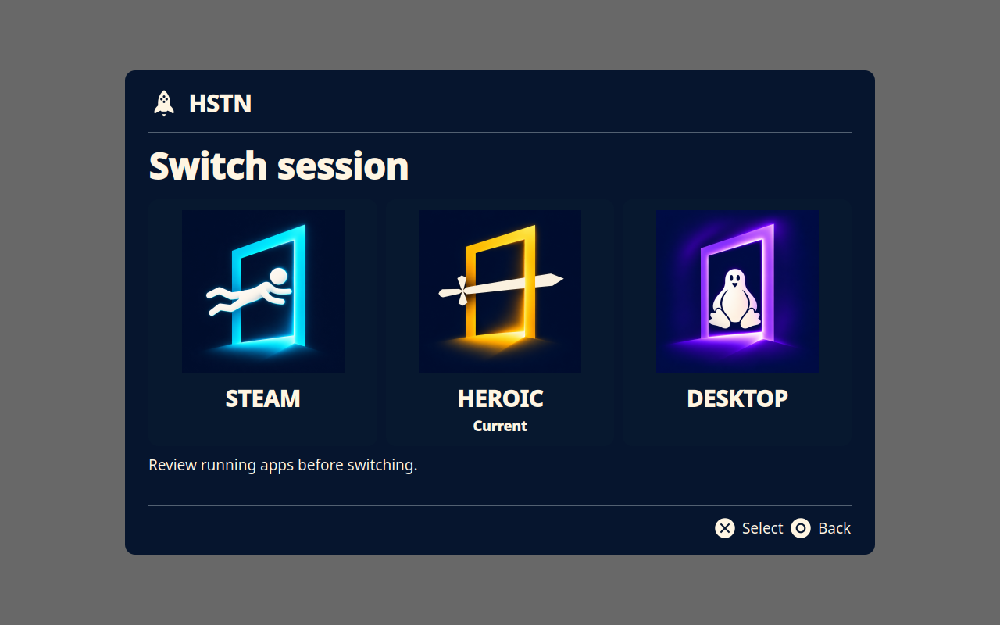
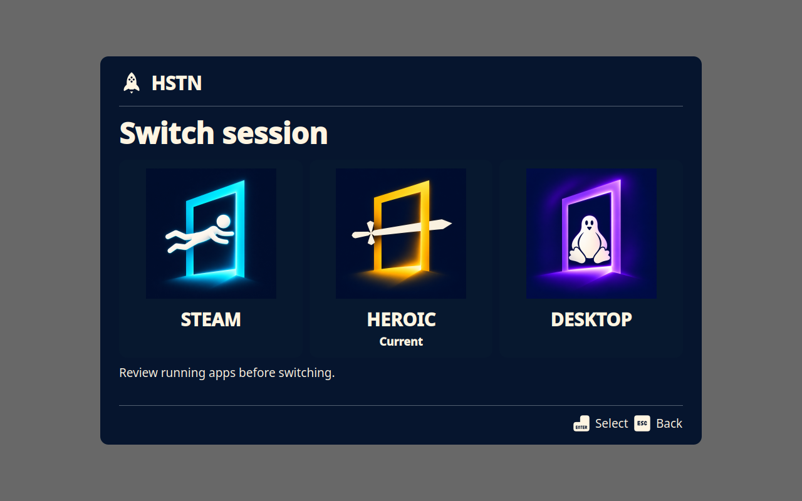
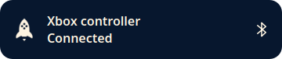
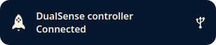

# Controller support previews

The overlay follows the last controller or keyboard used for navigation. Physical
Xbox and DualSense controllers retain their respective virtual output families.
Connection notifications identify the physical transport and do not take focus.

These images are rendered by offscreen Qt tests with synthetic data. The toast
has transparent rounded corners and no border. Its 80% window opacity is applied
by the compositor and is not represented in these widget captures.

| Xbox navigation | PlayStation navigation | Keyboard navigation |
| --- | --- | --- |
|  |  |  |

| Bluetooth notification | USB notification |
| --- | --- |
|  |  |

Automated checks cover physical-device detection, transport changes, mixed
controller routing, hotplug cleanup, ownership refusal, glyph switching, toast
focus flags, and transparent corner pixels. Full Bazzite hardware acceptance
across USB/Bluetooth, rumble, suspend/resume, Gamescope notifications, and session
transitions is still required. During development, a stale InputPlumber composite
reported a possible deadlock and required a separate daemon restart; HSTN does
not automatically restart InputPlumber or take over another controller owner.
