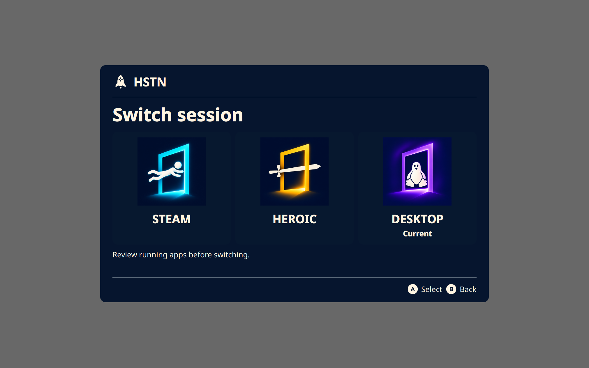

# Controller support previews

The overlay follows the last controller or keyboard used for navigation. Physical
Xbox and DualSense controllers retain their respective virtual output families.
Connection notifications identify the physical transport and do not take focus.

These images are rendered by offscreen Qt tests with synthetic data. The toast
has transparent rounded corners and no border. Its 80% window opacity is applied
by the compositor and is not represented in these widget captures.

| Xbox navigation | PlayStation navigation | Keyboard navigation |
| --- | --- | --- |
|  |  |  |

| Bluetooth notification | USB notification |
| --- | --- |
|  |  |

Automated checks cover physical-device detection, transport changes, mixed
controller routing, hotplug cleanup, ownership refusal, glyph switching, toast
focus flags, and transparent corner pixels. Full Bazzite hardware acceptance
across USB/Bluetooth, rumble, suspend/resume, Gamescope notifications, and session
transitions is still required. During development, a stale InputPlumber composite
reported a possible deadlock and required a separate daemon restart; HSTN does
not automatically restart InputPlumber or take over another controller owner.

## Legion Go S handheld profile

The internal input profiles separate physical controller actions and glyphs from
virtual output emulation. Go S uses the reusable handheld glyph family based on
Kenney's CC0 Steam Deck vectors. Existing Xbox and PlayStation bindings and
output policies remain distinct.

Go S support is gated by Lenovo DMI models 83L3, 83N6, 83Q2, and 83Q3 plus USB
controller IDs 1a86:e310/e311. Original Legion Go and Go 2 are outside this scope.
Guide + Quick Access opens HSTN; Guide alone retains launcher behavior. A selects,
B goes back, and L1/R1 scroll the app review. Accept and Back act on release to
keep InputPlumber's DBus target from retaining a held button after interception
ends. A first unmatched release can recover stale state; duplicate releases are
ignored.

An idle Go S composite can be adopted without recreating its native outputs.
Existing interception owners are preserved. InputPlumber has no activation-chord
getter, so cleanup restores the default Guide binding rather than an unknown
custom binding. One empty source entry is accepted only as the known Go S RGB
LED when the host, LED, and remaining physical sources are verified. Unknown,
mixed, and LED-only composites are refused.

### Desktop navigation and mouse controls

While HSTN is hidden, the original profile and normal controller forwarding
remain active. A/B, D-pad, sticks, touchpad, and triggers pass to Steam's desktop
layout. Only the completed Guide + Quick Access chord opens HSTN; an incomplete
Guide chord is replayed to the launcher on release.

While HSTN is visible, left stick, D-pad, A/B, and shoulders use DBus navigation.
Right stick, touchpad, and triggers retain their existing Steam mouse mappings;
Steam must be running, and KDE's input-control permission for Steam must be
allowed. The original InputPlumber profile is restored on close.

The root-owned guard serves a fixed-purpose Unix socket, verifies the active
seat UID and Go S sources, and journals before applying its navigation profile.
The caller cannot supply YAML, file paths, or commands. File-backed profiles and
profiles with target overrides are refused. Client EOF or guard restart restores
owned changes. Distinct edits and unresolved recovery records remain preserved.
PyYAML is required; the user runtime and system guard must be upgraded together.

DeckyPlumber 0.1.8 was identified by an administrator-started read-only D-Bus trace
as the source of Default-profile reloads during active-app changes. Its backend
restores the base profile even with no custom mappings selected. HSTN's lease
can reapply navigation over the exact recorded baseline, while preserving other
profile, source, and file-backed changes. The overlay checks while visible and
before selecting a session. Native keyboard/mouse selects queued during a reset
are discarded and the menu dismisses; DBus Accept remains usable. Hidden-menu
clicks cannot start a switch. A recovery conflict does not stop the independent
physical-input guard. No Decky plugin code or settings are changed.

### Steam and Heroic output compatibility

Steam/Desktop retain the existing output. Bazzite's native Steam helper is the
companion to its Disable OpenGamepadUI setting: it configures Deck UHID,
keyboard, and mouse once. HSTN's `ogui-steam` override sources packaged standard
Steam, matching the disabled overlay setting while retaining vendor arguments
and hooks. Both HSTN units order after the optional native helper. Enabling that
vendor helper restored native Go S prompts across a reboot on the tested device.

Deck UHID exposes the Go S raw HID identity 28de:12ff without a virtual gamepad
event device for Heroic's browser interface. In Heroic, the known native
Deck/keyboard/mouse combination temporarily becomes Xbox Elite/keyboard/mouse.
Existing Xbox and custom combinations are preserved. The output lease records
its original types and verified sources before mutation and waits for binding;
the restore watchdog reinstates the native output before releasing ownership.
Idle interrupted leases can be recovered. Different sources, custom outputs, or
other active owners are preserved, and unresolved recovery blocks updates and
uninstall. Readiness recognizes native Deck identities 28de:1205/12ff and the
Xbox Elite output; Steam's secondary 28de:11ff emulation cannot satisfy it.

### Rendering and service cleanup

Desktop uses native Wayland where available. On the tested 1920 × 1200 Go S at
KDE 190% scaling, this reports a 1011 × 632 logical screen with pixel ratio 2,
avoiding the previous enlarged XWayland buffer. Artwork and SVG prompts render
at physical density while layout remains logical. KWin places notifications
without taking focus. Gaming Mode retains X11 for Gamescope overlay properties.

The panel, text, art, and spacing use 75% of the previous size. Gaming Mode reads
Steam's saved `InstallConfigStore/UI/display/Current/ScaleFactor` from
`config/config.vdf` and watches changes. The magnifier and Desktop accessibility
settings are separate. Steam files are never written; incomplete writes retain
the last valid scale. Desktop scaling remains independent.

The background Desktop app identity matches its autostart entry and has a
NoDisplay application registration. It opts out of Qt session management, so
KDE does not restore the interactive Open HSTN shortcut on return to Desktop.
Isolation verification remains required. A controller-error fallback defaults
to Return to Desktop, and a stationary pointer cannot change that selection.

Desktop uses explicit systemd readiness after the endpoint and KWin bridge are
registered. Both units use cgroup lifetime so the restore watchdog can finish
after UI failure. A local transient-service fixture reproduced the old DBus
name-loss cleanup failure, then verified delayed child cleanup for simple and
notify services after main-process failure. See systemd's
[service lifetime and readiness documentation](https://www.freedesktop.org/software/systemd/man/latest/systemd.service.html).

### Validation

On-device acceptance used a Legion Go S model 83N6 with InputPlumber 0.83.0 on
Bazzite KDE. The user verified:

- Guide + Quick Access and repeated single-press A/B operation.
- Desktop left-stick/D-pad navigation alongside right-stick/touchpad mouse and
  trigger clicks, after allowing Steam's KDE input-control request.
- Hidden startup after returning from Gaming Mode and correct compact sizing.
- Heroic's own left-stick/D-pad navigation, A selection, and B back actions.
- Native Steam prompts after reboot and after leaving Heroic.
- A Heroic → Steam → KDE round trip with one B press dismissing HSTN. The guard
  journal recorded baseline-profile repair during that final Desktop open.

A controlled on-device automated check loaded the recorded baseline over an
active Desktop lease, verified navigation recovery, and rejected a queued native
select. It then created a readable Heroic Xbox Elite gamepad and restored the
original native output and mode 0, leaving no temporary journals. Final health
checks reported 56 passes with no warnings/failures; the normal Desktop overlay
was hidden with its controller ready and native Deck/keyboard/mouse outputs.
Temporary diagnostic services and overrides were removed.

Available regression coverage: 328 passing tests, including ownership/refusal,
rollback, repeat operations, profile resets, output recovery, DPI rendering,
installer lifecycle, and Steam configuration parsing. Two existing tests depend
on an untracked prototype helper absent from this worktree; they are excluded
from that count. Archive/native assembly and systemd unit validation also pass.
Both images above are synthetic Qt renders, without machine or app captures.

Rumble, suspend/resume, external-controller coexistence, and the other Go S
models still need hardware acceptance. Automated fixtures do not establish
support for untested devices.
