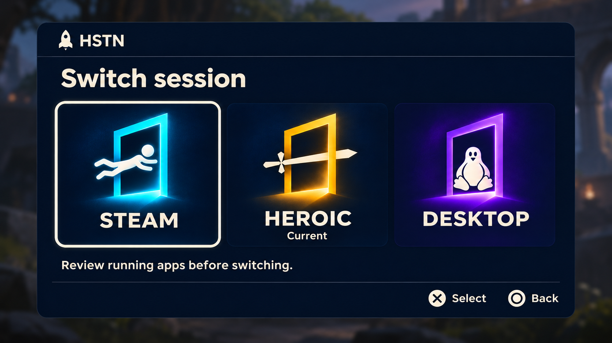
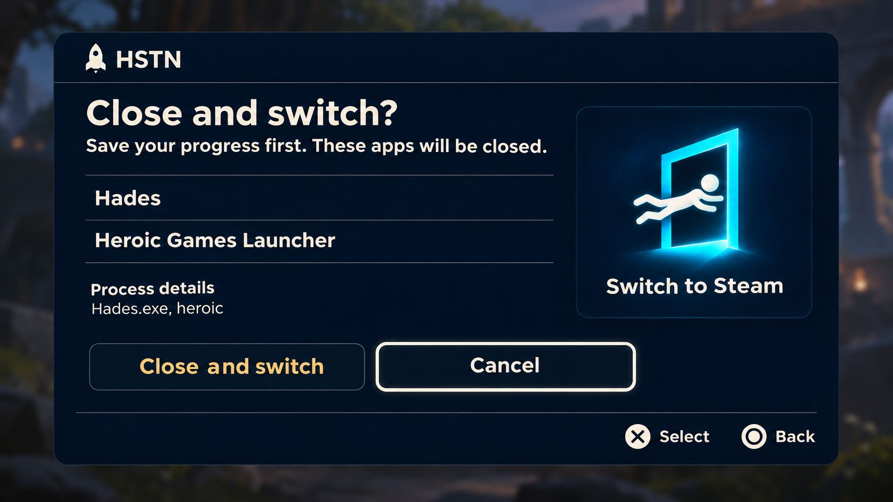

# HSTN overlay design brief

Approved visual direction · November 9, 2026  
Repository · [jeff-roche/hstn](https://github.com/jeff-roche/hstn)  
Behavior reference · `main` at `df33db7`. Recheck the current checkout and its `AGENTS.md` before implementation.

## Goal

Ship a controller-first overlay that lets Linux gamers switch among Steam, Heroic, and KDE Desktop from the couch. Make it clear which session is active, which destination has focus, and which apps would close. HSTN is pronounced “Houston.” Its tagline is “Mission control for Linux gaming sessions.”

The approved direction is **Launch Deck**, with the **upright rocket with four portholes** and a **single screen for app review and confirmation**. The mockups show example data. The interaction requirements below govern where mockup details differ from runtime behavior.

## 1. Launch Deck

- Center a rounded navy panel over the dimmed current view. Put the small ivory rocket and HSTN wordmark in the header, then the heading **Switch session**.
- Show Steam, Heroic, and Desktop in one horizontal row. Use the original square doorway images from the repo and render the destination names as live text. Keep their proportions and the full symbols visible.
- Mark the active session with **Current** when known. Keep it visually distinct from focus. The mockup uses Heroic as current and Steam as focused only to illustrate this distinction.
- Use an ivory focus outline with enough clearance to stay visible on every accent. The footer shows DualSense Cross **Select** and Circle **Back**. Give keyboard and mouse users equivalent access through the existing bindings.
- Use the helper text **Review running apps before switching.** Selecting a destination starts the existing switch check. Follow the current session detection and action availability rules. Where the active session is unknown, omit the **Current** label.

## 2. Review and confirm

- Keep the same panel, rocket header, and controller footer. Show **Close and switch?** and **Save your progress first. These apps will be closed.**
- List detected apps by display name in the left column. Keep process details secondary and accessible, including existing warnings about unidentified processes. The example Hades and Heroic entries are illustrative. Use the actual plan data and preserve per-app process grouping.
- Use the right column for the selected destination’s doorway image and live label, such as **Switch to Steam**. Use the corresponding asset and text for every destination.
- Put **Close and switch** and **Cancel** on one action row. **Cancel receives initial focus every time the review opens.** Use ivory for focus and amber for the close action. Cross activates the focused action. Circle or Escape cancels the review through the existing path.
- Keep actions reachable while reviewing long lists. Scroll the review content independently and preserve readable text and controller access at narrow sizes.

## Behavior and implementation boundaries

| State | Expected behavior |
| --- | --- |
| Checking | Use the existing asynchronous plan check. Show its status and prevent duplicate switch requests. |
| Apps found | Show review with Cancel focused. Execute the reviewed plan only on explicit **Close and switch**. |
| No apps found | Continue through the existing guarded switch path. |
| Cancel | Discard the review plan and return to the deck without closing apps. |
| Closing or switching | Use the existing progress and disabled-action behavior. |
| Blocked, changed, or failed | Preserve actionable status. If the app list changed, require a fresh review. Preserve guard and recovery behavior. |

Start with the native Qt UI in `src/session-overlay.py`. Preserve the Gamescope and KDE entry points, controller capture and release, current shortcut behavior, mouse and keyboard paths, and switch helper contracts. Reuse the existing state machine and planning/confirmation paths. Check that the new visual order matches focus traversal, especially the horizontal destination row and confirmation actions. Resolve runtime assets through the project’s packaging conventions so they work in installed and standalone builds. Keep existing launcher artwork and slot assignments intact.

## Visual system and assets

| Role | Starting value |
| --- | --- |
| Panel | Midnight navy `#06152E` |
| Text, rocket, focus | Warm ivory `#FFF5E2` |
| Steam | Cyan `#12D8F2` |
| Heroic | Gold `#FFD15A` |
| Desktop | Violet `#8B5CF6` |
| Close action | Warm amber, starting at `#FFD15A` |

Values are starting points based on the repo design guide. Use an installed sans-serif, bold headings, comfortable line spacing, and restrained chrome. Scale spacing and type against the actual viewport. Check legibility from couch distance and on a handheld. Keep glow primarily in the art. Use labels as well as color for meaning.

- [Editable rocket SVG](../../assets/logo/hstn-rocket.svg) and transparent PNG exports at [24 px](../../assets/logo/hstn-rocket-24.png), [48 px](../../assets/logo/hstn-rocket-48.png), and [256 px](../../assets/logo/hstn-rocket-256.png). The editable mark uses the original upright body and detached exhaust, with swept fins that echo the rounded grips of a controller. See the [approved rocket reference](references/03-approved-rocket.png). Four round transparent portholes sit at the cardinal points, like controller buttons. Use this selected logo in both screens. The two screen mockups predate the logo revision and show the original single window. Pair the updated SVG with a live **HSTN** wordmark.
- `assets/destinations/` includes exact copies of the repo’s Steam, Heroic, and Desktop square icons and wide banners. Prefer the original files already under `assets/artwork/` in the checkout. See `docs/DESIGN.md` and `manifest.json` for the artwork family and launcher mappings.
- `mockups/` contains the two approved screen references and the approved rocket reference. Use the separate assets and live UI text in the product.

## Future expansion

Keep session switching the default landing view. Leave room for a separate System section when there are real audio, controller, or performance features to expose. Add destinations through the existing artwork family and data where practical. Treat those ideas as future design space for this handoff.

## Acceptance checks for Codex

- Compare both overlay screens against the references. Check focus visibility, text and artwork cropping, and long app lists at handheld and TV sizes.
- Verify destination selection, cancellation by button and Back, default Cancel focus, explicit confirmation, zero-app flow, changed app list, and blocked or failed transitions. Verify controller, keyboard, and mouse where supported.
- Run `python3 -m unittest discover -s tests -v` and check that the installed or staged build resolves its visual assets. Use demo mode or fixtures for visual checks. Report Gamescope/KDE and controller hardware verification separately from automated results.
